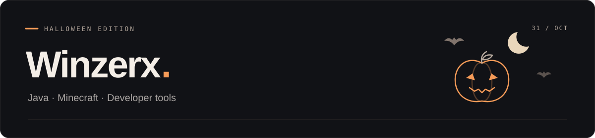

<p align="center">
  
</p>

<h1 align="center"><code>&lt;Winzerx /&gt;</code></h1>

```java
class Winzerx {
    String language = "Java";
    String project = "StrictVisionPlus";
    String[] interests = {"Minecraft", "AI anti-cheat", "Developer tools"};
}
```

- 🛡️ Разрабатываю **StrictVisionPlus** — свой ИИ-античит для **Minecraft**.
- 🎮 Создаю моды и плагины для **Minecraft**.
- ☕ Работаю с **Java**, **Fabric** и **Gradle**.
- 🛠️ Пишу утилиты для парсинга данных и автоматизации.

### `> languages & tools`

<p>
  
  
  
  
</p>

<p align="center">
  <a href="https://github.com/Winzerx?tab=repositories"></a>
</p>
